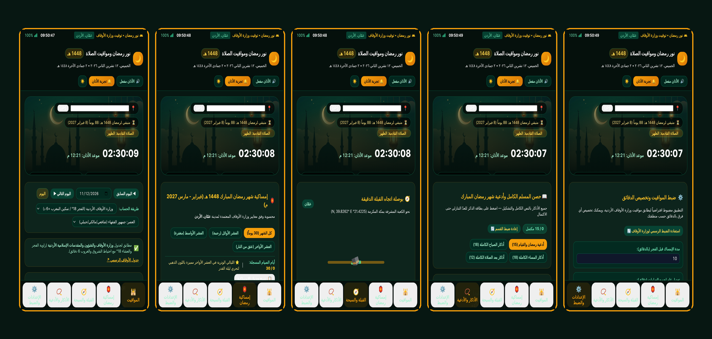
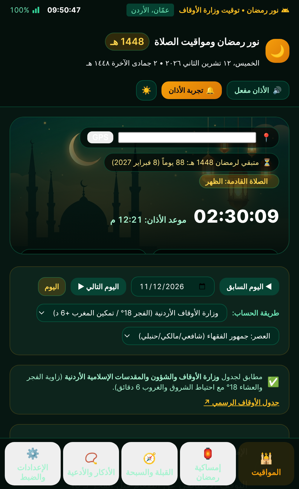
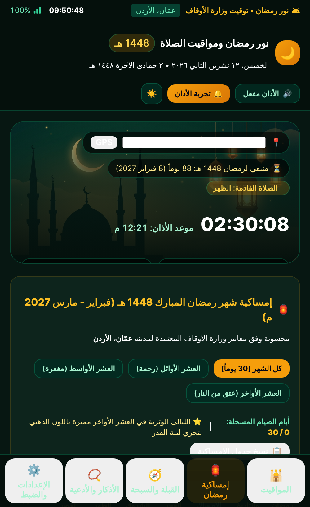
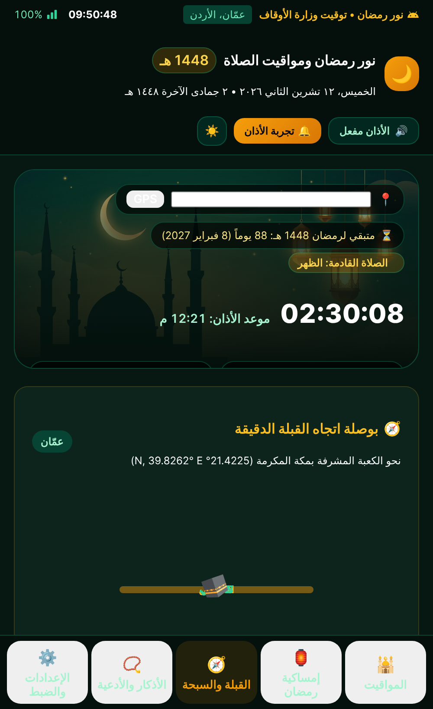
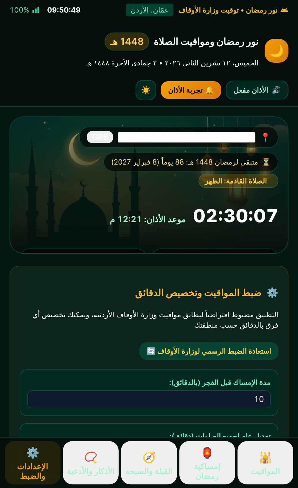

<div align="center">
  
  <h1>🌙 تطبيق نور رمضان ومواقيت الصلاة (Noor Ramadan Android App)</h1>
  <p><strong>تطبيق أندرويد وويب تفاعلي لمواقيت الصلاة الرسمية (مطابق لجدول وزارة الأوقاف الأردنية) وإمساكية شهر رمضان المبارك 1448 هـ / 2027 م</strong></p>
</div>


## ✨ المميزات الرئيسية (Key Features)

1. **مواقيت صلاة دقيقة مطابقة لوزارة الأوقاف الأردنية**:
   - معايير فلكية مضبوطة بدقة وفق جدول [وزارة الأوقاف والشؤون والمقدسات الإسلامية الأردنية](https://www.awqaf.gov.jo/ar/Pages/PrayerTime) ومنهجية [مواقيتنا](https://mawaqeetna.com/methodology/) (زاوية الفجر والعشاء `18°` تحت الأفق وفق فتوى دائرة الإفتاء العام رقم 3970، زوال الظهر الفلكي، واحتياط الشروق والغروب `6 دقائق`).
   - دعم محافظات المملكة الأردنية الهاشمية (عمّان، إربد، الزرقاء، السلط، العقبة) بالإضافة إلى المدن العربية والإسلامية الرئيسية (مكة المكرمة، المدينة المنورة، القدس، القاهرة، دبي، الكويت، الطائف) وتحديد الموقع عبر **GPS**.
2. **إمساكية شهر رمضان المبارك 1448 هـ / 2027 م**:
   - جدول كامل لـ 30 يوماً يبدأ من الاثنين 8 فبراير 2027 م وفق [إمساكية عمّان 1448 هـ](https://ahsebli.com/imsakiya-amman.html) و[تقويم أم القرى](https://ummalquracalendar.org/umm-al-qura-ramadan-calendar/).
   - تصفية سريعة حسب العشر الأوائل (رحمة)، العشر الأواسط (مغفرة)، والعشر الأواخر (عتق من النار) مع تمييز الليالي الوترية لتحري ليلة القدر ومتابعة الصيام اليومي.
3. **بوصلة القبلة التفاعلية والمسبحة الإلكترونية**:
   - حساب اتجاه القبلة الدقيق بالدرجات والمسافة بالكيلومترات نحو الكعبة المشرفة (`21.4225° N, 39.8262° E`) وفق [معادلة الدائرة العظمى](https://drishlabs.com/tools/qibla-direction).
   - مسبحة إلكترونية ذكية مع عداد تسبيح وأهداف قابلة للتخصيص (`33`، `99`، `100`) وتنبيهات صوتية.
4. **موسوعة الأذكار الكاملة وأدعية شهر رمضان (63 ذكراً ودعاءً كاملاً بالتشكيل)**:
   - أذكار الصباح الكاملة (`18` ذكراً)، أذكار المساء الكاملة (`18` ذكراً)، أذكار ما بعد الصلاة المفروضة (`12` ذكراً)، وأدعية شهر رمضان والقيام والقنوت (`15` دعاءً) بالنص الكامل غير المختصر مع عداد تفاعلي لكل ذكر.
5. **الإعدادات والضبط وحاسبة زكاة الفطر وختمة القرآن**:
   - تخصيص فروق الدقائق الفردية لكل صلاة على حدة، حاسبة زكاة الفطر وفدية الصيام، ومنظم ختمة القرآن الكريم في رمضان.

## 📱 لقطات شاشة من التطبيق (App Screenshots)



| مواقيت الصلاة اليومية | إمساكية رمضان 1448 هـ | القبلة والمسبحة | الأذكار والأدعية الكاملة | الإعدادات والضبط |
| :---: | :---: | :---: | :---: | :---: |
|  |  |  |  |  |

## 🗂️ هيكلة المشروع (Repository Structure)

```text
NoorRamadan-Android-App/
├── .github/workflows/android-build.yml   # بناء ملف APK تلقائياً عبر GitHub Actions
├── app/
│   ├── build.gradle.kts                  # إعدادات تطبيق الأندرويد (SDK 35 / Jetpack Compose)
│   └── src/main/
│       ├── AndroidManifest.xml           # صلاحيات الموقع والتنبيهات وأيقونة التطبيق
│       ├── assets/index.html             # التطبيق التفاعلي الكامل للعمل بدون إنترنت
│       ├── java/com/noorramadan/prayertimes/
│       │   ├── MainActivity.kt           # واجهة الأندرويد الرئيسية
│       │   └── PrayerTimeCalculator.kt   # محرك الحساب الفلكي المطابق لوزارة الأوقاف الأردنية
│       └── res/mipmap-*/ic_launcher.png  # أيقونات الأندرويد بجميع الكثافات القياسية
├── assets/
│   ├── icon/app_icon_512.png             # الأيقونة الرسمية بدقة 512×512
│   ├── images/ramadan_hero_banner.jpg    # صورة الخلفية الرمضانية
│   └── screenshots/                      # لقطات شاشة عالية الدقة لجميع تبويبات التطبيق
├── docs/index.html                       # نسخة جاهزة للنشر الفوري عبر GitHub Pages
├── build.gradle.kts
├── settings.gradle.kts
├── LICENSE
└── README.md
```

## 🚀 طريقة رفع المشروع على GitHub وتفعيل البناء التلقائي

1. قم بفك ضغط الملف `NoorRamadan_GitHub_Repository.zip`.
2. أنشئ مستودعاً جديداً (New Repository) على حسابك في **GitHub** باسم `NoorRamadan-Android-App`.
3. افتح الطرفية (Terminal / Git Bash) داخل مجلد المشروع ونفذ الأوامر التالية:

```bash
git init
git add .
git commit -m "Initial release: Noor Ramadan Prayer Times & Imsakiya Android App"
git branch -M main
git remote add origin https://github.com/<USERNAME>/NoorRamadan-Android-App.git
git push -u origin main
```

4. **تفعيل GitHub Pages (اختياري لمعاينة التطبيق عبر رابط مباشر)**:
   - من إعدادات المستودع (**Settings > Pages**)، اختر الفرع `main` والمجلد `/docs` ثم اضغط **Save**.
5. **تحميل ملف APK الجاهز**:
   - بمجرد رفع الكود، سيعمل ملف `.github/workflows/android-build.yml` تلقائياً في تبويب **Actions** لبناء ملف `NoorRamadan-debug-apk` لتنزيله وتثبيته مباشرة على هاتفك.
